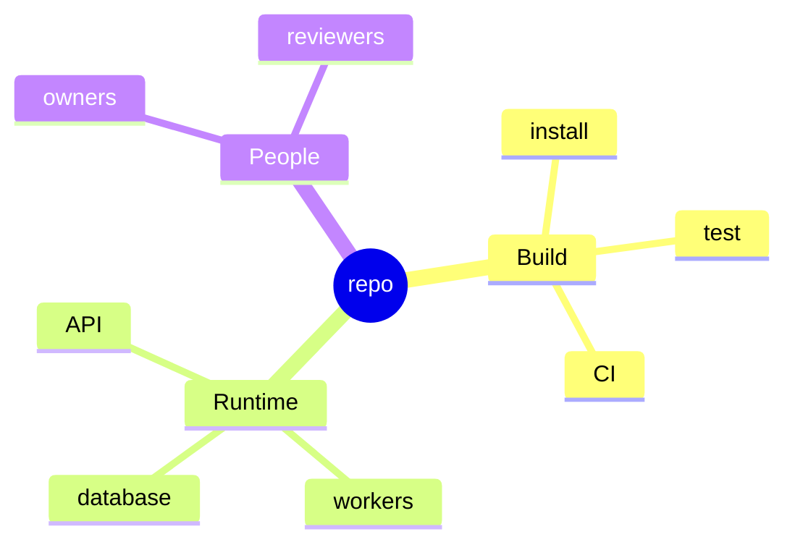

# Ramp up on a new repository with AI and a markdown knowledge base

Draft, 2026-11-23. A workflow for a person who has just joined a team and needs to learn an unfamiliar repository and its build. The agent does the searching and drafting; you do the checking and the learning, and you keep the result in a vault of markdown notes, such as an Obsidian vault.

This is a proposal, not playbook content. Each claim carries a grade, as in the playbook: P (primary source), R (research), S (second-hand) or D (design advice). `doc-checker` confirmed the research and primary-source claims on 2026-11-23 (sections "What the evidence says" and "Choosing the tool", and the Sources table). It did not check the practitioner rows, the Hacker News threads, DeepWiki, CodeTour, Nierenberg, Holloran or koru, which stay graded S or D.

## What the evidence says

1. **Ask the agent questions, as you would ask a teammate.** Anthropic calls codebase Q&A with Claude Code its "core onboarding workflow" and says no special prompting is needed (P, [best practices post](https://www.anthropic.com/research/claude-code-best-practices)). The Claude Code docs give prompt recipes for a new codebase: start broad, then narrow, ask about conventions, and ask for a glossary of project terms (P, [common workflows](https://code.claude.com/docs/en/common-workflows)).
2. **Delegating can cost you the learning.** In a randomized trial with 52 developers learning a new Python library, the group with an AI assistant scored 17% lower on a quiz straight afterwards, with the largest gap on debugging, and was not significantly faster. Those who used the AI to build understanding (follow-up questions, explanations, conceptual questions) kept more (R, [Anthropic](https://www.anthropic.com/research/AI-assistance-coding-skills), [paper](https://arxiv.org/abs/2601.20245)). The sample is small, the quiz came right after the task, and one critic argues the two groups' conditions were too different to compare (S, [review](https://jenniferplusplus.com/reviewing-how-ai-impacts-skill-formation/)). So: let the agent find things, and do the explaining back yourself.
3. **Big picture first, then small real tasks.** In a Microsoft study (32 developers, 15 managers, plus surveys), 67% of onboarding tasks led to learning. Developers who got the big picture before a task struggled less, and the common plan was simple tasks first, then harder ones (R, [Ju et al.](https://arxiv.org/abs/2103.05055)). Newcomers to open source also name reading tests and making small changes as good ways in (R, [first-contribution study](https://arxiv.org/abs/2404.18677)).
4. **The why and the history are what experts pass on.** In twelve observed onboarding sessions across eight organisations, experts explained design rationale and past, current and planned changes, and newcomers valued it highly (R, [Yates](https://doi.org/10.1007/s10664-019-09741-6)). The code cannot tell an agent this, so it is what your notes must capture from people.
5. **Generated overviews can be wrong, and look settled.** Generated repo wikis such as DeepWiki link claims to source lines, but can still misread metaprogramming, code generation and unusual designs, and lag the code (S, [DeepWiki docs](https://docs.devin.ai/work-with-devin/deepwiki)). Check every claim you build on.
6. **Keep your learning notes out of the agent's context file.** Context files, whether written by an LLM or a developer, "do not generally improve task success rates" and raised inference cost by over 20% on average (R, [Gloaguen et al., arXiv 2602.11988](https://arxiv.org/abs/2602.11988); [playbook §8](../../playbook/agent-harness-playbook.md#8-context-engineering)). Claude Code's own advice is to write down only what the agent can't find by reading the repo (P, [best practices](https://code.claude.com/docs/en/best-practices)). Your mind map is for you. The repo's `CLAUDE.md` gets only commands, gotchas and decisions the code doesn't show.

## What practitioners do

These are well-known practitioners describing their own methods. They show what people do, not that it works better; grade them D (design advice) unless noted.

| Who | Method | What to take |
|---|---|---|
| Dex Horthy, HumanLayer ([post](https://www.humanlayer.com/blog/advanced-context-engineering), [repo](https://github.com/humanlayer/advanced-context-engineering-for-coding-agents)) | Research, then plan, then implement, each in a fresh context, with the research written to a file. On a 300k-line Rust codebase he had never worked in, he threw out a wrong research doc and re-ran it with more steering. | Read and correct the research before anything else: "a bad line of research" costs more than a bad line of code. Keep context around 40 to 60% full; compact to files. |
| Addy Osmani ([Brownfield agentic engineering](https://addyosmani.com/blog/brownfield-agentic-engineering/)) | A read-only pass that writes a short comprehension memo: entry points, owners, callers, existing abstractions, tests, production signals, history, open questions, each claim citing a file, issue or dashboard. Then plan in a clean context. | Make the research a durable file, or the next session pays for the same archaeology. "Write down what the code can't say, and nothing else." |
| Simon Willison ([linear walkthroughs](https://simonwillison.net/guides/agentic-engineering-patterns/linear-walkthroughs/), [interactive explanations](https://simonwillison.net/guides/agentic-engineering-patterns/interactive-explanations/), [codebase Q&A](https://simonwillison.net/2025/Mar/11/using-llms-for-code/)) | Has the agent plan and write a linear walkthrough of the code, pulling snippets in with `cat`, `grep` or `sed` rather than retyping them, so the quoted code can't be invented. For a hard algorithm, asks for an animated explanation. For a quick look, pipes the whole repo into a long-context model with "architectural overview as markdown". | Ask for walkthroughs whose code comes from commands, not from the model's memory. He calls not understanding your code "cognitive debt" and uses walkthroughs to pay it down. |
| karun.me ([Use the agent to build your own understanding](https://karun.me/blog/2026/11/07/use-the-agent-to-build-your-own-understanding/)) | Reverses the roles: the agent teaches one level at a time, points to files to read, then quizzes him, and goes deeper only once he answers well. Every fact needs a file and line, or the answer is `UNKNOWN`. | The quiz-first loop and the `UNKNOWN` rule. He keeps his own learning notes on his machine and checks in only the list of sources the agent should read to rebuild a map. |
| OpenAI's Codex guide ([codebase onboarding](https://learn.chatgpt.com/use-cases/codebase-onboarding)) | Scope to a feature area, trace the request flow, ask which modules own business logic versus transport, persistence or UI, ask where validation and side effects happen, and end with the next files to read and the risky spots. | The closing question: "which files next, and what is risky here?" |
| Hacker News threads ([learning with agents](https://news.ycombinator.com/item?id=48691675), [legacy codebases](https://news.ycombinator.com/item?id=47890749), [larger codebases](https://news.ycombinator.com/item?id=46354970)) | Common advice: trace one request from entry point to database; ask "why", not "what"; keep a scratchpad file of notes and line numbers and restart from it; clear context between research, plan and build. One team reported most of Claude's claims about their 20-year-old codebase were wrong and digging "the old way" taught them more (S, anecdote). | Expect a messy legacy codebase to defeat a first pass. Check claims before you build on them. |

The common thread: **research into a file, a person checks it, then a fresh context acts on it** (HumanLayer, Osmani, the HN threads), and **the human builds the understanding, not just the agent** (Willison, karun.me, and the skill-formation study above).

## Choosing the tool

Any folder of markdown files in git will do; Obsidian is a good viewer for it.

- An Obsidian vault is a plain folder of markdown files, and Obsidian picks up edits made outside the app (P, [Obsidian help](https://help.obsidian.md/)). So Claude Code can run in the vault folder and write notes while you read them in Obsidian.
- Mermaid code blocks render as diagrams with no plugin. Flowchart nodes with the `internal-link` class open the note of the same name, but links inside diagrams do not show in Graph view, so also write a normal `[[wikilink]]` (P, [Obsidian help](https://help.obsidian.md/advanced-syntax)).
- Canvas is a core plugin for laying notes out in 2D; it saves `.canvas` files in the open JSON Canvas format (P, [Canvas](https://help.obsidian.md/plugins/canvas)).
- Bases is a core plugin that shows notes as tables, cards or kanban boards, built from their properties (P, [Bases](https://help.obsidian.md/bases)). A base over your `questions/` folder gives you an open-questions board.
- The Obsidian CLI needs the 1.12.7+ installer and the app running; it can search the vault and create notes from templates (P, [Obsidian CLI](https://help.obsidian.md/cli)). You do not need it: Claude Code reads the files directly.

**Before you start, check your employer's policy.** A personal vault that syncs to a cloud service must not hold the employer's source code, secrets or customer data. Keep code in the repository and keep only notes and `path:line` pointers in the vault. If in doubt, keep the vault on the work machine and in a work-approved place.

## The vault

The layout follows Karpathy's "LLM wiki" pattern: immutable raw sources, a wiki the agent maintains, and a schema file that tells the agent the rules, with an `index.md` catalog and an append-only `log.md` (S, [llm-wiki](https://gist.github.com/karpathy/442a6bf555914893e9891c11519de94f)). Here you also write pages yourself.

```text
work-vault/
├── CLAUDE.md            # the schema: layout and rules for the agent
├── index.md             # one line per page, by section
├── log.md               # append-only: "## [YYYY-MM-DD] ingest | title"
├── raw/                 # read-only sources: wiki exports, meeting notes, transcripts
├── repos/
│   └── <repo>/
│       ├── overview.md  # what it does, the map, entry points
│       ├── build.md     # install, build, test, CI, deploy, as you ran them
│       ├── flows/       # one note per traced request or job
│       ├── memos/       # comprehension memos, one per ticket
│       ├── glossary.md  # project terms
│       └── decisions.md # the why, from people and history
├── questions/           # one note per open question, status in properties
├── people/              # who owns what, and who to ask
├── daily/               # daily notes: what you did, learned, asked
└── templates/
```

Run `git init` in the vault and commit at the end of each day; the log of diffs becomes a record of what you learned (S, [Nierenberg](https://offbyone.us/posts/new-job-knowledge-base/)).

### The vault's `CLAUDE.md`

```markdown
# Work vault rules

- raw/ is read-only. Never edit or delete files there.
- Never copy source code into this vault. Cite code as `repo/path:line` at a commit.
- Every claim about code carries a citation, and is marked (observed) if you read it
  in the code or (inferred) if you are guessing.
- New pages link to at least one existing page with [[wikilinks]] and get a line in index.md.
- After each change, append to log.md as `## [YYYY-MM-DD] <ingest|query|lint> | <title>`.
- Questions go in questions/<slug>.md with `status: open|answered` and `ask:` (a person or "code").
- Diagrams are Mermaid code blocks, at most about 15 nodes; split bigger ones.
```

## The workflow

### Day 0: set up (one hour)

1. Create the vault from the layout above, open it in Obsidian ("Open folder as vault"), and `git init` it.
2. Clone the work repository somewhere else. Do not put it inside the vault.
3. Start Claude Code in the repository and add the vault, so one session sees both: `claude --add-dir /path/to/work-vault`.
4. Put any team wiki pages, onboarding docs and your first meeting notes in `raw/`.

### Days 1 to 3: make the build run

The first milestone is the build and tests passing on your machine. Nothing else you learn sticks as well.

1. Ask for the build map (prompt 2 below), then run each command yourself.
2. Write `repos/<repo>/build.md` as you go: what worked, what failed, the fix, and how long each step took.
3. Every surprise (a missing env var, a slow test, a step nobody wrote down) becomes a question note or a line in `build.md`. These are also the lines the repo's `CLAUDE.md` may be missing, so offer them to the team.

### Week 1: draw the map

1. Ask for the overview and the module map (prompts 1 and 3). The agent writes them to `overview.md`.
2. Spot-check at least five citations by opening the file at that line. Fix or delete what is wrong, and note in `log.md` how many were wrong, so you know how far to trust the next one.
3. Trace one real request or job end to end (prompt 4) into `flows/`.
4. Build the glossary (prompt 5).
5. Explain it back. Close the agent and draw the map from memory, or ask the agent to quiz you (prompt 7). Where you get stuck is where to read next.

### Week 2 onward: learn by small tasks

1. Take a small real ticket. Before you change anything, ask where the change goes and why (prompt 6), then make the change yourself or have the agent make it while you predict each step.
2. After each task, update the flow and decision notes it touched, and close the questions it answered.
3. Take the open questions that only people can answer to your mentor in one batch; write the answers into `decisions.md` with who said it and when.

### Weekly: lint the vault

Ask the agent to health-check the vault (prompt 8): broken links, orphan pages, claims whose cited lines have changed, questions left open more than a week.

## Prompts for understanding a new repository

Three rules apply to every prompt here, taken from the evidence above:

- **Ask for citations and for honesty about guesses.** "Cite `path:line` for each claim, and mark anything you inferred rather than read."
- **Say it is read-only.** "Do not change any files in the repository." (Plan mode does the same.)
- **Ask for the reasoning, not just the answer.** Follow-up and "why" questions are what kept people learning in the skill-formation study.

### 1. Orientation tour

```text
I'm new to this repository. Give me a tour: what the product does, the entry points,
the top-level directories and what each is for, and the five files I should read first,
in order, with one line on why. Cite path:line for each claim and mark anything you
inferred. Don't change any files.
```

### 2. Build and test map

```text
Map the build for me: how to install dependencies, build, run all tests, run one test
file, lint, and start the app locally. Then trace what CI runs (read the CI config) and
how a merge reaches production, if the repo shows it. List every environment variable
or external service the build needs. Give each command exactly as I should type it,
with the file you got it from. Mark anything you could not confirm.
```

### 3. Module map as a diagram

```text
Draw the main modules and how they depend on each other as a Mermaid flowchart of at
most 15 nodes, named exactly as the directories are. Below it, list each edge with the
import or call that proves it (path:line). Write it to
/path/to/work-vault/repos/<repo>/overview.md under "## Module map".
```

For a mind map of concepts rather than code, use `mindmap` in place of `flowchart`. Mind maps are a newer Mermaid type, and Obsidian's bundled Mermaid can trail upstream, so test one small map first.



### 4. Trace one flow

```text
Trace what happens when <a user logs in | a job runs | an order is placed>, from the
entry point to storage and back. One numbered step per hop, each with path:line and one
sentence. Then draw it as a Mermaid sequence diagram. Note any step where you are unsure
which branch runs.
```

### 5. Glossary

```text
List the project-specific terms, abbreviations and domain words used in this code and
its docs, with a one-line definition each and where it is defined (path:line). Flag
terms used in two different senses.
```

### 6. Before a change

```text
I need to <ticket summary>. Before any code: where would this change go, which existing
pattern should I follow (show the closest example), what tests cover the area, and what
could break? Explain why, as you would to a new teammate. Don't write the change yet.
```

### 7. Quiz me

```text
Quiz me on this repository, one question at a time, mixing conceptual, code-reading and
debugging questions about the parts in repos/<repo>/overview.md and flows/. Wait for my
answer, tell me if I'm right with a path:line that shows it, then ask the next one.
Stop after ten and list what I got wrong.
```

### 8. History and rationale

```text
Using git log and blame (read-only), tell me why <file or pattern> is the way it is:
the commits that shaped it, linked issues or PRs if the messages name them, and anything
that looks like a temporary fix. Separate what the history shows from your guesses.
Then list the questions only a person could answer, for me to ask.
```

### 9. Teach me, one level at a time

Adapted from the karun.me teach-and-quiz prompt (see "What practitioners do").

```text
Onboard me onto this codebase, one level at a time. Start with the whole system: the
main concepts, how the code is structured, key design decisions, how it is built,
deployed and run, and the history behind it. After each level, point me to the two or
three files I should read myself, then quiz me on what you taught and what I read. Go
deeper only once I answer well; if I get something wrong, explain it again. Back every
fact with a file and line. For "why", use ADRs, commit messages and docs. If nothing
proves it, say UNKNOWN. Don't guess.
```

### 10. Linear walkthrough

After Simon Willison's walkthrough prompt. It writes code excerpts, so keep the file in the repository (a local branch or an ignored path), not in your vault.

```text
Read the source for <area>, then plan a linear walkthrough that explains how it works,
in the order a request flows through it. Write it to walkthrough.md. Include code
snippets only by running cat, sed -n or grep on the real files, never by retyping
code, so every snippet is exact. Add a short explanation after each snippet.
```

### 11. Comprehension memo before a change

After Addy Osmani's comprehension memo. Run it in a read-only session, check it, then plan in a fresh one.

```text
Read-only. For <ticket>, write a comprehension memo to
/path/to/work-vault/repos/<repo>/memos/<ticket>.md: entry points, owners (CODEOWNERS or
git history), callers, existing abstractions to reuse, tests that cover this area,
relevant history, and open questions. Every claim cites a file and line, an issue or a
commit; anything you can't prove goes under "Open questions". No code excerpts.
```

### 12. Lint the vault

```text
Health-check /path/to/work-vault: broken [[links]], pages with no inbound links, claims
whose cited path:line no longer matches the code, questions open more than a week, and
pages missing from index.md. Report first; change nothing until I say which to fix.
```

## Templates

### `repos/<repo>/flows/<flow>.md`

```markdown
---
type: flow
repo: <repo>
commit: <short sha>
status: draft | checked
---
# <Flow name>

Trigger: ...
Steps:
1. `path:line` — ...
2. ...

```mermaid
sequenceDiagram
  ...
```

Open questions: [[questions/...]]
Related: [[overview]], [[glossary]]
```

### `questions/<slug>.md`

```markdown
---
type: question
repo: <repo>
status: open
ask: code | <person>
asked: YYYY-MM-DD
---
# <The question>

Context: ...
Answer: ... (source: `path:line` or <person>, <date>)
```

## Check that it works

- [ ] The build and tests run on your machine, and `build.md` holds the exact commands.
- [ ] You spot-checked five or more citations per generated page, and logged the error rate.
- [ ] You can draw the module map and one flow from memory.
- [ ] Each open question has an owner (code or a person).
- [ ] No source code, secrets or customer data are in the vault.
- [ ] Anything you added to the repo's `CLAUDE.md` is something the agent could not find by reading the code.

## Other tools, and when to reach for them

- **Generated repo wikis** (DeepWiki for public repos; private ones need a Devin account) give a quick first map with source links. Treat them as one more `raw/` source and check them like any other (S, [DeepWiki docs](https://docs.devin.ai/work-with-devin/deepwiki)).
- **Code tours** (CodeTour in VS Code) are annotated walkthroughs. A small study saw signs they steer newcomers to relevant files, but found nothing statistically significant (R, [Taylor, PPIG 2022](https://www.ppig.org/files/2022-PPIG-33rd-taylor.pdf)).
- **Obsidian MCP servers and sidebar plugins** add Obsidian's search index and backlinks to the agent. Start without them: running Claude Code in the folder covers most needs, and plugins run with full access to your computer (S, [comparison](https://www.koru.do/en/blog/obsidian-claude-code)).

## Sources

| Source | Grade | Used for |
|---|---|---|
| [Claude Code best practices (Anthropic, 2025)](https://www.anthropic.com/research/claude-code-best-practices) | P | Codebase Q&A as Anthropic's onboarding workflow |
| [Claude Code docs: common workflows](https://code.claude.com/docs/en/common-workflows) | P | Prompt recipes for new codebases |
| [Claude Code docs: best practices](https://code.claude.com/docs/en/best-practices) | P | Write down only what the agent can't find |
| [How AI assistance impacts the formation of coding skills (Anthropic, 2026)](https://www.anthropic.com/research/AI-assistance-coding-skills) | R | Delegation lowers learning; asking for explanations helps |
| [How AI Impacts Skill Formation (arXiv 2601.20245)](https://arxiv.org/abs/2601.20245) | R | Study design and numbers |
| [Review of the skill-formation study (Moore, 2026)](https://jenniferplusplus.com/reviewing-how-ai-impacts-skill-formation/) | S | Methodological critique |
| [Onboarding in software teams (Ju et al., Microsoft)](https://arxiv.org/abs/2103.05055) | R | Big picture first; simple to complex tasks |
| [Towards the first code contribution](https://arxiv.org/abs/2404.18677) | R | Tests and small changes as a way in |
| [Transfer of program comprehension in onboarding (Yates)](https://doi.org/10.1007/s10664-019-09741-6) | R | Rationale and history views |
| [A tour through code (Taylor, PPIG 2022)](https://www.ppig.org/files/2022-PPIG-33rd-taylor.pdf) | R | Code tours |
| [Obsidian help: CLI, Canvas, Bases](https://help.obsidian.md/) | P | Tool facts |
| [LLM wiki (Karpathy)](https://gist.github.com/karpathy/442a6bf555914893e9891c11519de94f) | S | Raw, wiki and schema layers; index and log |
| [Personal knowledge base for a new job (Nierenberg)](https://offbyone.us/posts/new-job-knowledge-base/) | S | Questions page, daily notes, git for the vault |
| [Mermaid in Obsidian (Holloran)](https://danholloran.me/posts/mermaid-diagrams-in-obsidian-architecture-docs-that-live-next-to-your-notes) | S | `internal-link` class, node limits |
| [Obsidian and Claude Code setups (koru)](https://www.koru.do/en/blog/obsidian-claude-code) | S | `--add-dir`, MCP options, plugin risk |
| [DeepWiki docs (Cognition)](https://docs.devin.ai/work-with-devin/deepwiki) | S | Generated wikis and their limits |
| [Gloaguen et al., arXiv 2602.11988](https://arxiv.org/abs/2602.11988); playbook §8 | R | Context files don't improve success and cost over 20% more |
| [Advanced context engineering (HumanLayer)](https://www.humanlayer.com/blog/advanced-context-engineering) | D | Research, plan, implement; review research first |
| [Brownfield agentic engineering (Osmani)](https://addyosmani.com/blog/brownfield-agentic-engineering/) | D | Comprehension memo; write down what the code can't say |
| [Agentic engineering patterns (Willison)](https://simonwillison.net/guides/agentic-engineering-patterns/linear-walkthroughs/) | D | Linear walkthroughs, interactive explanations |
| [Use the agent to build your own understanding (karun.me)](https://karun.me/blog/2026/11/07/use-the-agent-to-build-your-own-understanding/) | D | Teach-and-quiz loop; `UNKNOWN` rule |
| [Codex: understand large codebases (OpenAI)](https://learn.chatgpt.com/use-cases/codebase-onboarding) | D | Scoped flow tracing; next files and risky spots |
| Hacker News threads linked above | S | Community practice and one counter-example |
