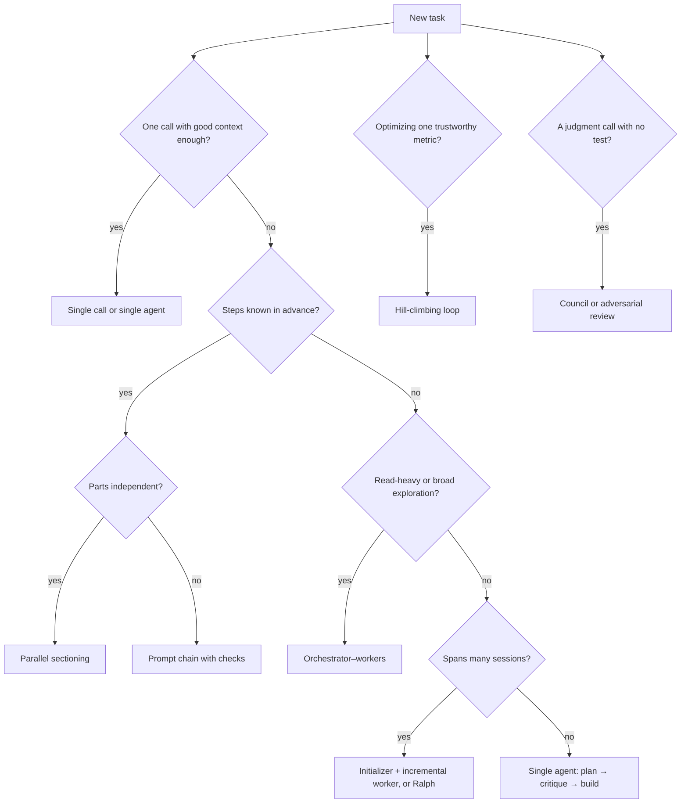

<!-- Generated by tools/build_index.py from ENTRY.md and the playbook. Do not edit; rebuild. -->
# Phase 4 Orchestrate: who does what?

Sections and templates this route names, in order: 6, 7, 3A, C. Runbook, if you need its steps: wiki/orchestrate.md.

<!-- id: 6 -->
## 6. Orchestration patterns
*Read when: you are choosing how many agents to run and how they hand work to each other.*

**Page terms.** Orchestration patterns (the page's "shapes", Lesson 7, "Pick the right shape for the job").

| # | Pattern | Shape | Use when | Cost and risk | Source |
|---|---|---|---|---|---|
| 1 | Prompt chaining | Fixed steps with checks between them | The task splits into known stages | Low; brittle if a stage varies | [P] Building effective agents |
| 2 | Routing | Classify, then dispatch | Inputs need different handling | Low; misroutes | [P] |
| 3 | Parallel sectioning | Split independent parts, run at once | Subtasks don't depend on each other | Tokens scale with parts | [P] |
| 4 | Parallel voting | Same task N times, compare | You need confidence or diverse attempts | N times the cost | [P] |
| 5 | Orchestrator–workers | Lead decomposes at runtime, workers report back | Subtasks can't be predicted ahead | About 15x chat tokens; coordination errors | [P] Building effective agents; multi-agent research |
| 6 | Evaluator–optimizer | Generate, critique, revise | Criteria are clear and iteration helps | Loops forever if criteria are vague | [P] |
| 7 | Plan → critique → execute | Plan file, fresh critic, then build | Multi-file or risky work | One extra review pass | [P] best practices; [S] team tips |
| 8 | Initializer + incremental worker | First session sets up the environment, a feature list and a progress file; each later session finishes one feature | Projects that span many sessions | Needs well-designed state files | [P] long-running harness |
| 9 | Ralph loop | A shell loop feeds the same prompt file to a fresh agent each pass; state lives on disk; one item per pass | A well-specified backlog with strong tests | Burns tokens and drifts if specs or tests are weak | [P] Huntley |
| 10 | Hill-climbing loop | Human edits the instructions file; agent edits the code; fixed time budget per attempt; one metric; keep if better, git reset if not; runs until interrupted | Optimization against one trustworthy metric | Metric gaming; the repo's instructions forbid editing the evaluation script, so enforce that with a read-only mount or code owners [D] | [P] Karpathy's autoresearch |
| 11 | Council | Independent answers, anonymized peer ranking, chair synthesis | Judgment calls, architecture options, research questions | About 9 model calls by default (4 answers, 4 reviews, 1 chair) [D]; the repo calls itself a vibe-coded Saturday hack, unsupported | [P] Karpathy's llm-council |
| 12 | Adversarial review | A fresh agent is told to break the plan or diff and return its strongest objections | Before irreversible or high-risk changes | False alarms; objections must be answered, not obeyed | [P] best practices; [D] |
| 13 | Research → plan → implement | Three separate phases, compacting to files between them; human reviews research and plan | Large or unfamiliar codebases | Discipline overhead | [P] HumanLayer |
| 14 | Day shift / night shift | Human-in-the-loop discovery and planning by day; an unattended loop works the sliced issues one by one, testing and typechecking every commit; QA findings become new issues | A backlog of well-sliced issues with strong checks | Needs a real sandbox | [P] Matt Pocock (the name is ours) |
| 15 | Compound loop | Plan, work, review, then capture what was learned so the next task is easier | Teams running many similar tasks | Rule bloat unless pruned | [P] Every |
| 16 | Goal loop | `/goal <condition>`: an evaluator re-checks the transcript after each turn and continues until the condition holds | A single session with a provable end state | The condition must be visible in output | [P] Claude Code docs |

The "cost and risk" column is our advice [D]; the source column names where each pattern comes from.

Two versions of "Ralph" exist. Huntley's original restarts a fresh process each pass. Anthropic's ralph-wiggum plugin re-feeds the prompt inside one session through a Stop hook. Dex Horthy (HumanLayer) has argued the plugin misses the key point of Ralph, a fresh context each pass. [S] One user's plugin loop set to `max_iterations: 0` ran 6,239 iterations over about 11.7 hours. Always set an iteration cap. [P: GitHub issue #1699]



---

<!-- id: 7 -->
## 7. Delegation protocol
*Read when: you are writing a brief for a helper agent, or setting what must come back.*

**Page terms.** Delegation protocol (the page's Lesson 6, "One lead, many helpers"). The page says "helper" for what this file also calls a worker or a subagent.

**What a brief must contain.** Anthropic found vague briefs cause duplicated work and gaps. Each subagent needs an objective, an output format, guidance on tools and sources, and clear task boundaries. [P]

**Effort scaling** (embedded in the lead's prompt). [P] This table comes from Anthropic's research system, where the work splits into independent reads. For coding, start from one writer and add helpers only for reading and review (§19.3).

| Task | Agents | Tool calls |
|---|---|---|
| Simple fact-finding | 1 | 3 to 10 |
| Direct comparison | 2 to 4 subagents | 10 to 15 each |
| Complex research | More than 10 subagents, divided responsibilities | As needed |

**More rules from the multi-agent research system.** [P]
- Spawn subagents in parallel and let them call tools in parallel; this cut research time by up to 90%.
- Subagents write outputs to files and pass lightweight references back, avoiding a "game of telephone".
- The lead saves its plan to memory, because context beyond 200,000 tokens gets truncated.

**Brief schema** [D]

```yaml
objective: what to return, and the decision it feeds
context: what is known; what is already ruled out
scope: where to look; what not to touch; read-only or not
tools: which tools and sources to prefer or avoid
output: format, length cap, file path to write
budget: max tool calls or minutes
stop: when to stop and report partial results
```

**Return schema** [D]

```yaml
summary: 3 to 5 lines
findings:
  - claim: one line
    evidence: file:line or URL
    confidence: high | medium | low
unknowns: what could not be found
artifacts: paths written
```

**House rules** [D]
- One writer per set of files; a git worktree per builder.
- Reviewers get the artifact and the criteria only.
- A helper's report is a claim, not proof. The lead re-checks any claim that drives a decision.
- Never forward raw transcripts between agents; forward summaries and file paths.

---

<!-- id: 3A -->
## 3A. Claude Code feature map
*Read when: you need the Claude Code feature for a job, or its limits, before you design around it.*

**Page terms.** Claude Code feature map (the page's "Toolbox", Lesson 8, "Which Claude feature does which job").

Checked against code.claude.com on 2026-10-24 [P]. Features marked preview or experimental change fast; re-check before you build on them.

| Job | Feature | Key facts and limits |
|---|---|---|
| Workers | Subagents | Markdown files in `.claude/agents/`, `~/.claude/agents/` or a plugin. Frontmatter sets `tools`, `disallowedTools`, `model`, `permissionMode`, `maxTurns`, `isolation: worktree`, `skills`, `mcpServers`, `hooks`. Built-ins include Explore and Plan (read-only). Nesting goes 3 levels deep by default. Plugin-supplied agents ignore `hooks`, `mcpServers` and `permissionMode`. |
| Big fan-outs | Dynamic workflows | Claude writes a JavaScript script that runs dozens to hundreds of subagents. Intermediate results stay in script variables, not the context window; verifier agents cross-check claims and list what they could not verify. `/workflows`, `/deep-research`. Paid plans (Pro turns it on in `/config`), and with Anthropic API, Bedrock, Google Agent Platform or Foundry access. |
| Peer agents | Agent teams (experimental) | A lead and teammates share a task list and message each other. Off by default; no worktree isolation, so partition files; not available under `-p`. |
| Overview | Agent view (preview) | `claude agents` shows background sessions as running, needs input or done; peek, reply, attach. |
| Session to session | Cross-session messaging | `ListAgents` and `SendMessage` pass text between your own sessions. |
| Recipes | Skills | `SKILL.md` loads on demand; `disable-model-invocation: true` keeps side-effect workflows manual. Bundled: `/batch` (5 to 30 worktree subagents, each opening a PR), `/loop`, `/verify`, `/run`, `/code-review`. Every enabled skill's name and description costs context on every turn, unless `disable-model-invocation: true` keeps the description out or `skillOverrides` shows the name only or hides the skill. |
| Distribution | Plugins and marketplaces | Bundle skills, agents, hooks and MCP servers; install with `/plugin install name@marketplace`. Enabled plugins run hooks and MCP servers as you. |
| Isolation | Worktrees | `claude -w <name>` creates `.claude/worktrees/<name>` on a new branch; `.worktreeinclude` copies gitignored files in. |
| Must-happen rules | Hooks | 33 events, among them PreToolUse, PermissionRequest, PermissionDenied, PostToolUse, SubagentStop, TaskCompleted, Stop, StopFailure, PreCompact, Notification, SessionStart and SessionEnd. Handlers: command, HTTP, MCP tool, prompt, subagent. |
| Goal pursuit | `/goal <condition>` | A small evaluator checks the transcript after each turn and keeps Claude going until the condition is met, judged impossible, or an error stops it. It runs no commands itself, so write a condition that the session's output can prove. |
| Repeat in session | `/loop` | Fixed interval (1-minute minimum) or self-paced; recurring tasks expire after 7 days; missed runs are not caught up; ends with the session, though `--resume` or `--continue` restores unexpired fixed-interval tasks (not self-paced ones). |
| Repeat on a schedule | Cloud scheduled tasks (`/schedule`, formerly "routines", preview); desktop scheduled tasks | Cloud tasks run on a schedule, an API call or a GitHub event, with a 1-hour minimum interval. They start in auto mode and can still stop and wait for an answer (ask rules, repeated auto-mode blocks), so design for a paused run. Each run starts from a fresh clone of the default branch (a run triggered by a PR event starts from the PR head) and pushes to a `claude/` branch unless the prompt says otherwise, so files it writes don't reach the next run unless merged; keep loop state in a ticket, a PR comment or a named branch. The 1-hour minimum applies to timed triggers. Desktop tasks run locally and need the app open and the machine awake. |
| Watch | Monitor tool | Streams a background process's output into the session line by line. |
| Headless | `claude -p`; Agent SDK | `--output-format text/json/stream-json`, `--allowedTools`, `--permission-mode dontAsk`, `--max-budget-usd`. `--bare` skips hooks, skills, MCP and CLAUDE.md discovery, so your Stop gate does not run, and it needs an API key or cloud-provider credentials rather than your subscription login. Since v2.1.302, `-p` starts in Manual mode when nothing sets a mode, so actions that need approval are denied. The Agent SDK (Python, TypeScript) runs the same loop in your code. |
| Off the machine | Claude Code on the web; Remote Control; Channels | `claude --cloud` runs a cloud VM from your GitHub repo, or uploads a local bundle when there's no GitHub remote or the Claude GitHub App isn't installed; you create the PR afterwards. In the CLI, `--teleport` pulls the result back one way; the desktop app can also send a local session to the cloud. Remote Control drives a local session from claude.ai or the phone. Channels push outside events (chat apps) into an open session through MCP. |
| Team chat | Slack, Claude Tag | Claude Tag (beta, Team and Enterprise) runs @Claude as a shared org identity in an ephemeral sandbox. |
| Safety | Permission modes; sandbox; managed settings | Modes: default, acceptEdits, plan, auto, dontAsk, bypassPermissions. Deny rules hold in every mode. Bash sandbox: Seatbelt on macOS, bubblewrap on Linux and WSL2. |
| Memory | CLAUDE.md, imports, auto memory | Managed, user, project and local CLAUDE.md; `@path` imports; the first 200 lines or 25 KB of auto memory load each session. All advisory: enforcement belongs in hooks. |
| Observability | OpenTelemetry | `CLAUDE_CODE_ENABLE_TELEMETRY=1` plus OTLP exporters: session and cost metrics; events for API requests, tool results and tool decisions. Repo files cannot turn it on. |

**The official best-practices page, condensed** [P]:
1. Give Claude a pass/fail check so it can iterate without you.
2. Explore, plan, implement, commit; skip the plan for a one-sentence diff.
3. Point at specific files, sources and existing patterns.
4. Keep CLAUDE.md short.
5. Pre-approve safe tools and use the sandbox; hooks for must-happen rules; skills for procedures; subagents to keep research out of the main context.
6. Have Claude interview you, write a spec, then implement in a fresh session.
7. Correct course early; `/clear` after repeated failed corrections; `/compact` with a focus.
8. Add an adversarial review subagent in a fresh context; act only on correctness findings.
9. Scale out with `claude -p` loops, writer/reviewer sessions and `/batch`.

---

<!-- id: C -->
### C. Subagent brief

```text
Objective: <what to return, and the decision it feeds>
Already ruled out: <so it isn't redone>
Already decided: <decision-log entries closed by a reviewer or a human; flag a problem, don't reopen it>
Look here: <files, folders, URLs>
Scope: read-only. Do not edit anything. Stop after <N> files or sources.
Return (under 400 words): summary; findings with file:line or URL and confidence
(high/medium/low); what you could not find. Write long output to <path> and return the path.
```
