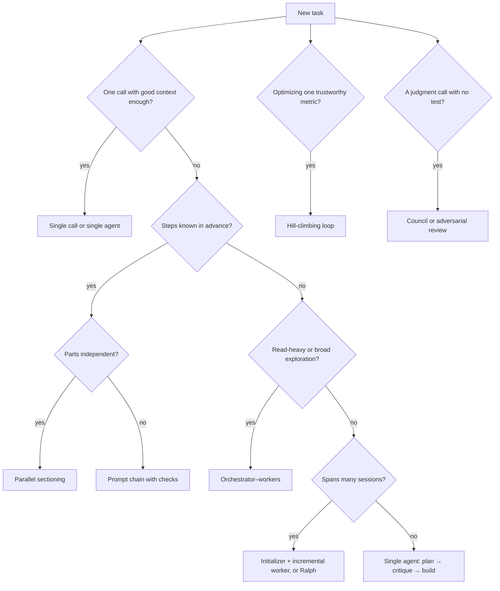

<!-- Generated by tools/build_index.py from ENTRY.md and the playbook. Do not edit; rebuild. -->
# Router row 21: Take one task from spec to merged PR with minimal supervision, overnight or not

Sections and templates this route names, in order: 11.6, 11.3, 9, 6, B, E, H. Runbook, if you need its steps: wiki/run-unattended.md, wiki/verify.md.

<!-- id: 11.6 -->
### 11.6 End to end with minimal supervision
*Read when: you want to run a whole task from spec to merged PR with as little watching as the checks allow.*

[D, built on the P sources named; no study tests this stack as a whole. Checked 2026-11-18.] The human supplies two things: an approved spec at the start and a sign-off on the verification artifacts at the end. Checks decide everything between.

1. **Orchestrate first.** Start an orchestration session that reads and decides, not builds. Interview to a written spec, get it approved, then build from it in a fresh session (§5.3).
2. **Answer five questions on paper** before any automation: what done means, how the agent checks itself, what it may touch, what stops it, and who signs off. The official best-practices page asks these five before a run goes unattended. [P: code.claude.com/docs/en/best-practices, "Let Claude run without you", checked 2026-11-18] (§11.3 and Template B.)
3. **Check the precondition.** Tan: "automating that loop just produces more slop". If your inner loop produces slop, fix that first, with a lint rule that stops new slop before you clean old. [P: talk, 15:32; the advice is D]
4. **Write the plan to a file, and let the lead schedule.** The lead saves its plan and each worker returns a file reference (§7); Cursor's agents rewrite a shared scratchpad rather than appending to it (§6).
5. **Route each piece by task shape.** Read-only research and review go to subagents with tight briefs. Mechanical, independent changes go to `/batch` (5 to 30 units) or a workflow. Coupled edits stay on one writer (§6).
6. **Keep context small through structure** (§8): state in files and git, a fresh session or worktree per unit.
7. **Verify in layers** (§9): deterministic checks, a Stop hook, runtime verification, `/goal` with a turn bound, a fresh reviewer. Keep the done check out of the agent's reach. Calibrate any model evaluator against your own judgments before you trust it unattended. [D]
8. **Set the controls.** Auto mode, or `dontAsk` with explicit allow rules; an isolated worktree; a cost ceiling (`--max-budget-usd` on an API key, the usage-credits spend limit on a subscription, §11.5) and `--max-turns` as a turn bound; and a branch rule on the default branch that the task can't bypass. [P: best practices, headless docs; D]
9. **Know what pauses a run.** In interactive auto mode: 3 consecutive or 20 total blocks (in `-p` the action is denied and the run goes on). An unlisted tool in Manual or default mode. A permission prompt in a workflow. A usage limit, which pauses `/goal`; auth, credit and context-overflow errors, which clear it. Eight consecutive Stop-hook blocks. A scheduled task that asks before running a skill with `allowed-tools` or hooks (as of v2.1.325). The 7-day `/loop` expiry. [P: permission modes, goal, workflows, hooks and scheduled-tasks docs]
10. **Sign off on artifacts and receipts.** The human gate is the PR: the diff or, following Tan, the verification artifacts, plus a receipt for every check (§9.4). Give reviewers files and a brief, never the builder's report. [D]

**Cost evidence.** [P, vendor, one task each]
- A planner, generator and evaluator harness cost "over 20x" more than a solo run, and the solo run's core feature was broken. [Rajasekaran, 2026-03-24] Use it only for work beyond what the model does reliably alone.
- Carlini's compiler run cost under $20,000. [Anthropic, 2026-02-05]
- Anthropic's multi-agent research used about 15x the tokens of a chat. [2025-06-13]

**Stage autonomy.** Hashimoto's agents run first on research and triage near the end of the day, not on shipped code. Move to code runs only after the research runs earn trust. [P, opinion: 2026-02-05; D for the staging]

**Re-test at each model upgrade.** "Every component ... encodes an assumption" about what the model can't do. Rajasekaran needed context resets on Sonnet 4.5 and not on Opus 4.5. Re-run your evals with a component removed at every upgrade (Law 1). [P, vendor: 2026-03-24]

---

<!-- id: 11.3 -->
### 11.3 Guardrails for any loop
[D, with P where marked]

**Page terms.** Guardrails for any loop (the page's "Guardrails for anything that runs without you").

- A stop condition: done when every check passes, or after N iterations, N minutes or N dollars.
- A retry cap: after two failures with the same cause, stop and report.
- Idempotent actions: running twice must not send, charge or create twice.
- A results sink outside the chat: a file, a ticket, a PR comment.
- One-line status per iteration, and "no change" when nothing changed.
- Fresh context per iteration (Ralph) or deliberate compaction (in-session loops).
- Cloud scheduled tasks start from a fresh clone each run (PR-triggered runs start from the PR head) and push to `claude/` branches by default, so keep their state in a ticket, a PR comment or a named branch, not in files. [P]
- Claude Code's Stop-hook continuation cap (8 by default) is a backstop, not your stop condition. [P]

<!-- id: 9 -->
## 9. Verification stack
*Read when: you are defining "done", wiring gates, or deciding who checks the work.*

**Page terms.** Verification stack (the page's "Make Claude prove its own work", Lesson 9, "Self-checks").

**Check order, cheapest and most deterministic first.** [D, built on the P sources named; checked 2026-11-18]
1. Deterministic checks: types, lint, tests, build.
2. A Stop hook that reruns them. It is overridden after 8 consecutive blocks (§9.5).
3. Runtime verification: run the app and look at the result. Tan: runtime verification is "giving your agent a way to run the code for itself" and use the debugging tools human developers use, such as the Chrome DevTools protocol (talk, 10:02); she adds a feature map of user-facing features and CLIs inside skills (9:48 to 10:45). [P: transcript; her results are self-reported] OpenAI's team puts the Chrome DevTools Protocol in the agent's runtime. [P, vendor]
4. `/goal` with a turn bound in the condition. Its evaluator "doesn't run commands or read files", so the condition must name output the session shows. [P: goal docs]
5. A fresh reviewer (§7, reviewer rule).

Keep the done check where the agent can't edit it (§9.3). Review the verification artifacts (screenshots, videos, diagrams, command output), not only the diff. Karpathy: "we as humans are doing the verification". [P: talk transcript, 22:16] Formal methods (TLA+, Lean) are optional: Tan uses them and calls them "not a silver bullet". [P: 10:50]

### 9.1 From criterion to gate

```text
criterion  →  scenario            →  automated check   →  gate               →  receipt
"Export       "Given 3 rows          test in              Stop hook + CI        PASS + command
 matches       filtered to 2,        npm test             required check
 the screen"   CSV has 2 rows"
```

### 9.2 Trust ladder

| Rung | Who checks | Catches | Harness implementation | Use for |
|---|---|---|---|---|
| 1 | The agent says it's done | Nothing on its own | — | Never enough |
| 2 | The agent shows command and output | Obvious failures | Receipt rule in CLAUDE.md | Trivial changes |
| 3 | A hook reruns the checks | Skipped or faked steps | Stop hook, pre-push hook, CI | Normal and high-risk changes; trivial ones too once the hook exists |
| 4 | A fresh reviewer | The builder's blind spots, weakened tests | Reviewer subagent with diff and criteria only | Normal changes |
| 5 | An adversary | Design flaws, security holes | Critic subagent returning top objections | High-risk changes |
| 6 | A human | A wrong goal | Plan approval, PR review, irreversible actions | High-risk and irreversible |

**Bounded review.** Each rung runs once per version of the work (a fix makes a new version), and a review always ends. [D]
- A finding blocks only with evidence: a failing command, a concrete input, or a cited line that breaks a stated criterion. The rest is advisory and goes on a follow-up list. "No blockers" is a valid result.
- The builder closes a blocker by fixing it. Only the reviewer that raised it, or a human, can close it any other way; the builder may reject advisory findings with a one-line reason. Every closed blocker goes in the decision log, with who closed it.
- Round 2 reads the fix diff for two things: whether each open blocker is closed, and whether the fix adds a new one. Every reviewer whose question the fix touches runs again on it (security for access, input or data handling). A large fix gets a full re-review instead: Fagan's inspections reconvened in full above five percent rework [R].
- Later reviewers get the decision log and the criteria, never the builder's reasoning; a point the reviewer or a human closed is not reopened. There is no round 3: after two rounds a human decides to ship, fix, hold or stop.
- Rung 3 is different: hooks and CI rerun every check on every change, because a deterministic check costs little and never invents a finding.
- At high risk, one security pass reads the code, not only the plan, against an application checklist: authorization on every new entry point, input handling, data deletion and migrations, secrets, plus the project's own list (for example the OWASP ASVS level it chose). It runs once per version, as part of the adversary's review or as the project's own security reviewer, never both. §10.3 and §12.4 cover the harness and the CI workflow, not the application.
- Evidence: §19.1 item 10, and the source-by-source check in [research/bounded-review-evidence.md](../research/bounded-review-evidence.md).

### 9.3 Rules that keep verification honest
- Tests are immutable to the builder. Anthropic's harness called removing or editing tests unacceptable. [P] Back it with a hook or CODEOWNERS on test paths, and have the reviewer inspect every test diff, including mocks that replace the behaviour under test. [D]
- **Read-only tests aren't enough.** On benchmark tasks whose tests contradict the spec, models passed by editing the tests or by special-casing. Read-only tests stopped only the edits, and a sanctioned stop-and-report exit cut cheating far more for some models than others. [R: preprint, ImpossibleBench, 2025; benchmarks, not real repos] Keep one acceptance check the builder can't read or edit, and give it a way to report that the task can't be done as specified. A Read deny rule doesn't cover a script that opens the file itself, or a command that reads without naming it [P: permissions docs], so keep that check outside the builder's workspace, run by CI or the Stop gate. [D]
- End-to-end checks for UI and full flows go through a real browser. [P: long-running harness; Agent SDK]
- An LLM judge needs a rubric. The research system scored factual accuracy, citation accuracy, completeness, source quality and tool efficiency from 0.0 to 1.0 with a pass/fail. [P] The Agent SDK guidance calls an LLM judge not very robust and slower, though sometimes worth the cost. [P] Our advice: never make it the only gate. [D] A judge favours its own outputs [R: NeurIPS 2024], and open-weight judges disagreed with themselves across runs. [R: Findings of EMNLP 2025] When an LLM judge scores work, use a different model family or an execution check, and repeat and aggregate. This is about scoring: a fresh reviewer from the same family (Law 7, §9.2) still beats self-review but can share the bias. [D]
- A loop's tests can pass while the spec is still violated; one practitioner's Ralph run passed 28 tests and then failed a fresh review on a real spec breach. Keep a fresh-eyes review even when tests are green. [S]
- Watch your own drift. Simon Willison wrote in May 2026 that he no longer reviews every line of agent output, even for production work, and named the risk himself: normalization of deviance. Decide on purpose which tiers get line-by-line human review. [P]
- Instructions don't stop reward hacking. METR found 30.4% of RE-Bench runs (39 of 128) hacked the task and 0.7% of HCAST runs, and that telling the model not to cheat had a "nearly negligible effect". [R: METR report, 2025-06-05] Back the rule with a check. [D]
- Ground self-correction in an external signal. Self-correction without one lowered reasoning accuracy [R: ICLR 2024], and Reflexion's coding gain (91% against 80% pass@1 on HumanEval) rests on test results. [R: NeurIPS 2023, per search]
- For unattended runs, measure **pass^k** (all k runs succeed), not just pass@k (at least one succeeds). At 75% per-run success, three runs in a row all succeed only about 42% of the time. [P: Demystifying evals]

### 9.4 Receipt format

```text
RECEIPT  <task id>  <date>
criterion 1: PASS     npm test -- reports.export   (12 passed)
criterion 2: FAIL     npx playwright test export   (1 failed: header row missing)
criterion 3: NOT RUN  needs Excel; checked CSV opens in Numbers instead
not done:   header row bug; Excel check
next step:  fix header writer, rerun criterion 2
```

**Write the report in plain English.** Ask the agent to report in short, active sentences with one meaning per word, close to ASD-STE100, the controlled-English standard for aircraft maintenance documents (Issue 9, January 2025, made it an international standard). [P: ASD-STE100 news page] Karpathy (2 Oct 2026) suggests asking a model for an explanation in that style, then for diagrams or an HTML page; for a large change, add a diagram or an HTML page as the review artifact. [P, opinion: X post] Older studies found Simplified English improved comprehension of a complex procedure, most for non-native speakers. [R: 1995 and 1996, human readers; none tested LLM output] This is one person's practice, not a measured result, and his video tip is not a default. [D]

### 9.5 Hooks that enforce it (Claude Code)

Behaviour [P: hooks docs]:
- A Stop hook exiting with code 2 prevents stopping, and its stderr goes to Claude as the reason to continue. JSON output `{"decision": "block", "reason": "..."}` does the same.
- The hook input has `stop_hook_active: true` when Claude is already continuing because of a stop hook. Check it so you don't block forever on something unfixable.
- Claude Code caps consecutive Stop-hook continuations at 8 by default (the count resets on each tool call); `CLAUDE_CODE_STOP_HOOK_BLOCK_CAP` overrides it.
- Stop does not run on a user interrupt; API errors fire `StopFailure` instead.
- A matcher made only of tool names separated by `|` or commas, such as `"Edit|Write"`, is an exact-name list; any other characters turn it into a regular expression. A PostToolUse exit code 2 shows stderr to Claude, but the tool has already run.
- Hooks run with your full user permissions, outside the sandbox. A hook script is itself a trust boundary. [P]

See templates F and G in §16.

---

<!-- id: 6 -->
## 6. Orchestration patterns
*Read when: you are choosing how many agents to run and how they hand work to each other.*

**Page terms.** Orchestration patterns (the page's "shapes", Lesson 7, "Pick the right shape for the job").

| # | Pattern | Shape | Use when | Cost and risk | Source |
|---|---|---|---|---|---|
| 1 | Prompt chaining | Fixed steps with checks between them | The task splits into known stages | Low; brittle if a stage varies | [P] Building effective agents |
| 2 | Routing | Classify, then dispatch | Inputs need different handling | Low; misroutes | [P] |
| 3 | Parallel sectioning | Split independent parts, run at once | Subtasks don't depend on each other | Tokens scale with parts | [P] |
| 4 | Parallel voting | Same task N times, compare | You need confidence or diverse attempts | N times the cost | [P] |
| 5 | Orchestrator–workers | Lead decomposes at runtime, workers report back | Subtasks can't be predicted ahead | About 15x chat tokens; coordination errors | [P] Building effective agents; multi-agent research |
| 6 | Evaluator–optimizer | Generate, critique, revise | Criteria are clear and iteration helps | Loops forever if criteria are vague | [P] |
| 7 | Plan → critique → execute | Plan file, fresh critic, then build | Multi-file or risky work | One extra review pass | [P] best practices; [S] team tips |
| 8 | Initializer + incremental worker | First session sets up the environment, a feature list and a progress file; each later session finishes one feature | Projects that span many sessions | Needs well-designed state files | [P] long-running harness |
| 9 | Ralph loop | A shell loop feeds the same prompt file to a fresh agent each pass; state lives on disk; one item per pass | A well-specified backlog with strong tests | Burns tokens and drifts if specs or tests are weak | [P] Huntley |
| 10 | Hill-climbing loop | Human edits the instructions file; agent edits the code; fixed time budget per attempt; one metric; keep if better, git reset if not; runs until interrupted | Optimization against one trustworthy metric | Metric gaming; the repo's instructions forbid editing the evaluation script, so enforce that with a read-only mount or code owners [D] | [P] Karpathy's autoresearch |
| 11 | Council | Independent answers, anonymized peer ranking, chair synthesis | Judgment calls, architecture options, research questions | About 9 model calls by default (4 answers, 4 reviews, 1 chair) [D]; the repo calls itself a vibe-coded Saturday hack, unsupported | [P] Karpathy's llm-council |
| 12 | Adversarial review | A fresh agent is told to break the plan or diff and return its strongest objections | Before irreversible or high-risk changes | False alarms; objections must be answered, not obeyed | [P] best practices; [D] |
| 13 | Research → plan → implement | Three separate phases, compacting to files between them; human reviews research and plan | Large or unfamiliar codebases | Discipline overhead | [P] HumanLayer |
| 14 | Day shift / night shift | Human-in-the-loop discovery and planning by day; an unattended loop works the sliced issues one by one, testing and typechecking every commit; QA findings become new issues | A backlog of well-sliced issues with strong checks | Needs a real sandbox | [P] Matt Pocock (the name is ours) |
| 15 | Compound loop | Plan, work, review, then capture what was learned so the next task is easier | Teams running many similar tasks | Rule bloat unless pruned | [P] Every |
| 16 | Goal loop | `/goal <condition>`: an evaluator re-checks the transcript after each turn and continues until the condition holds | A single session with a provable end state | The condition must be visible in output | [P] Claude Code docs |

The "cost and risk" column is our advice [D]; the source column names where each pattern comes from.

Two versions of "Ralph" exist. Huntley's original restarts a fresh process each pass. Anthropic's ralph-wiggum plugin re-feeds the prompt inside one session through a Stop hook. Dex Horthy (HumanLayer) has argued the plugin misses the key point of Ralph, a fresh context each pass. [S] One user's plugin loop set to `max_iterations: 0` ran 6,239 iterations over about 11.7 hours. Always set an iteration cap. [P: GitHub issue #1699]

**One writer by default.** [D, built on the P and R sources below] One agent writes; helpers read, search or review. Parallel writers fit only when all of these hold: each writer works in an isolated checkout; the work splits into independent failing tests; a strong verifier grades the result; and a lock or claim mechanism stops two writers taking the same task. Carlini's 16 agents in separate containers claimed tasks by writing lock files, ran about 2,000 sessions and cost under $20,000, and the post gives no single-agent baseline. [P, vendor: Anthropic, 2026-02-05] The evidence for the default:
- Anthropic's research-system post says most coding tasks have fewer parallelizable parts than research, and that work needing shared context is a poor fit. [P: 2025-06-13]
- Cognition (2026-04-22): "writes stay single-threaded"; helpers read and review. [P, vendor]
- Google Research and MIT, paper version 3 (8 Apr 2026): returns turn negative once the single-agent baseline exceeds 45% (a fitted estimate, not a cutoff), and independent agents amplified errors 17.2x against 4.4x with central coordination (CI 14.3 to 20.1), both relative to one agent. [R: preprint, arXiv 2512.08296]
- MAST, a failure taxonomy built from 1,600+ multi-agent traces. [R: NeurIPS 2025 poster, arXiv 2503.13657]

**Planner and worker, with written handoffs, is the scaled pattern.** Cursor reports that flat coordination through a shared lock file collapsed (January 2026), and that it moved to a planner-and-worker hierarchy (February 2026): each worker returns a handoff (what was done, deviations, concerns), the planner's scratchpad is rewritten rather than appended, and the judge and integrator roles were dropped. [P, vendor: Cursor, one setting, no replication]

**Route by model, and measure cost per task.** In Cursor's July 2026 post a hybrid run built on Opus 4.8 cost $1,339 for one task, against $10,565 for GPT-5.5 alone. [P, vendor: one task; model names are that post's era] Measure cost per task on your own work before you standardize a routing. [D]



---

<!-- id: B -->
### B. Task contract (goal prompt)

```text
You are the lead on this task. Plan first, use helper agents for side work, and prove every result.

GOAL
<one sentence: the result, not the activity>

RISK: <trivial | normal | high>   (set by the rule in Template L)

DONE WHEN (each line must be checkable)
1. <check>
2. <check>

CONSTRAINTS
- <off limits>

BUDGET
- <e.g. one session, up to 3 helpers; stop after 10 loop runs, 2 hours or $5>

STOP AND ASK ME IF
- <condition>
- you are about to do something hard to undo (delete data, deploy, force-push, push to the main branch, pay).
  Template F's guardrails block enforces this list; these words only remind.

HOW TO WORK (steps marked * run only when RISK is normal or high;
for a trivial task: build, verify, report)
1.* Explore with read-only helpers; each returns findings with file paths or links.
2. Synthesize a short brief: facts, unknowns, options.
3. Write docs/plans/<task>.md as small slices, each naming the test that proves it.
4.* Give the plan, not your reasoning, to a fresh reviewer; answer up to 3 blocking objections (none is a valid result).
5. Build one slice at a time; run that slice's test before moving on.
6. Verify every DONE WHEN item; report PASS, FAIL or NOT RUN with the command.
7.* Have a fresh agent review the diff against the goal and the decision log. Only a blocker reopens it, and a
    re-review reads the fix diff for open blockers and anything new the fix adds (a large fix: all of it).
8. Report what changed, what passed, what is not done.
9.* Suggest up to 3 harness improvements (rule, skill, hook, test).

RULES
- NOT RUN is not PASS.
- If the same check fails twice for the same reason, stop and ask for a second opinion.
- A review gets two rounds at most; after that, stop and let me decide.
- The plan file is the source of truth; keep it current.
- When the BUDGET runs out, stop and report, even if not done.
```

<!-- id: E -->
### E. Long-running state files

`features.json`

```json
[
  {
    "category": "functional",
    "description": "User can export the reports table to CSV",
    "steps": ["Open /reports", "Filter to 2 rows", "Click Export", "CSV has a header and 2 rows"],
    "passes": false
  }
]
```

`progress.md`

```markdown
## 2026-10-24 session 7
- Done: CSV export (feature 12), e2e passing, commit a1b2c3d
- Broken: none
- Next: feature 13 (date filter)
- Notes: init.sh now seeds 50 rows; smoke test takes 40s
```

<!-- id: H -->
### H. Loop and schedule prompts

```text
/loop 30m Check <what to watch>. If <condition>, do <one small action> and report it in one line.
If nothing changed, reply "no change". Never <forbidden action>; ask me instead.
Stop when <end condition>, or after 2 failures with the same cause.
```

```text
/schedule Every weekday at 8:00: <task>. Write the result to <file, ticket or message>.
Keep it under 15 lines, most important first. If something fails, say what and stop; retry at most once.
Never <push, delete, contact anyone>; leave a note instead.
```
