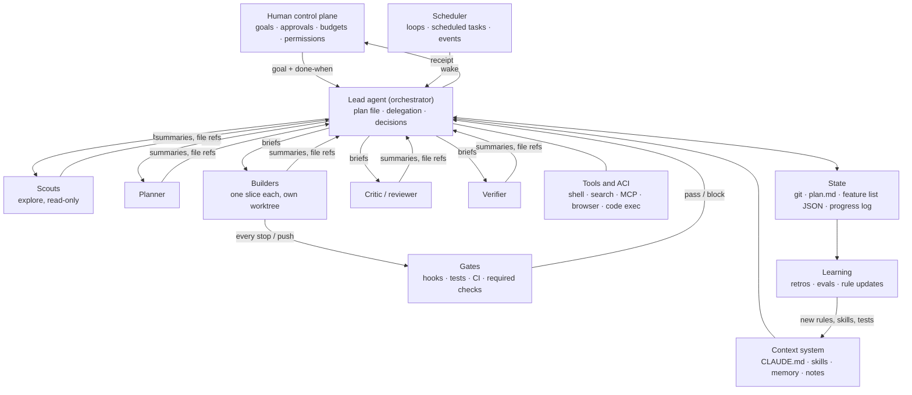

<!-- Generated by tools/build_index.py from playbook/agent-harness-playbook.md. Do not edit; rebuild. -->
## 3. Reference architecture
*Read when: you are drawing or reviewing the whole system, or deciding which layer owns a job.*

**Page terms.** Lead agent (orchestrator) is the page's "lead"; workers (subagents) are the page's "helpers" (Lesson 6, "One lead, many helpers").

- **Text version of the diagram.** The human control plane (goals, approvals, budgets, permissions) sends a goal and a done-when list to the lead agent (orchestrator), which holds the plan file and returns a receipt.
- The lead sends briefs to five kinds of worker (scouts, planner, builders, critic or reviewer, verifier) and gets summaries and file references back; scouts are read-only, and each builder takes one slice in its own worktree.
- The lead is connected to the tools and ACI (shell, search, MCP, browser, code execution) and to the context system (CLAUDE.md, skills, memory, notes).
- Every builder stop or push goes through the gates (hooks, tests, CI, required checks), which pass or block back to the lead; the lead reads and writes state (git, plan.md, feature list JSON, progress log).
- The scheduler (loops, scheduled tasks, events) wakes the lead; state feeds learning (retros, evals, rule updates), which sends new rules, skills and tests back into the context system.

| Layer | Job | In Claude Code | Building on the Agent SDK or API |
|---|---|---|---|
| Control plane | Set goals, approve plans and irreversible actions, set budgets | Plan mode approval, permission modes, allow/ask/deny rules, managed settings | An approval tool call that pauses the loop; config for budgets |
| Orchestrator | Hold the plan, delegate, decide | The main session | Your loop with a lead system prompt |
| Workers | Isolated jobs with clean context | Subagents (`.claude/agents/*.md`, own tools and model) | Separate model calls, run in parallel |
| Tools and ACI | Act on the world | Built-in tools, MCP servers, CLIs | Tool definitions: consolidated, namespaced, concise responses |
| Context | The right information at the right time | CLAUDE.md, skills, memory, imports | Prompt assembly plus on-demand retrieval |
| Gates | Make checks non-optional | Hooks, sandbox, CI required checks | Post-step validators that can reject output |
| State | Survive context resets and restarts | Git and files | Same, plus a database if multi-user |
| Scheduler | Keep it running | `/loop`, cloud scheduled tasks, GitHub Actions | Cron or a queue plus headless runs |
| Learning | Improve over time | Retros, CLAUDE.md edits, skills | An eval suite plus versioned prompts and tools |

---
