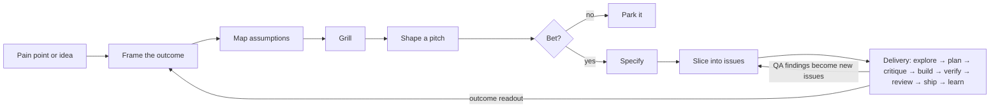

<!-- Generated by tools/build_index.py from playbook/agent-harness-playbook.md. Do not edit; rebuild. -->
## 5. Lifecycle: from idea to production
*Read when: you are taking a pain point or an idea to agent-ready issues, or running one issue through delivery.*

**Page terms.** Appetite (the page's "time budget"). Discovery, from pain point to issues (the page's "Idea to issues", Lesson 3).

The lifecycle has two halves. **Discovery** turns a pain point into issues an agent can finish. **Delivery** turns each issue into shipped, verified code. Humans own the "why" and the bets; agents do most of the drafting and nearly all of the legwork. [D]

### 5.1 Discovery: from pain point to issues

| # | Stage | Purpose | Artifact | Who decides | Exit gate |
|---|---|---|---|---|---|
| 1 | Frame | Name who struggles and what progress they want | Outcome card: the job in the customer's words, the metric to move | Human | The outcome has a number |
| 2 | Map assumptions | Find what must be true | Desirability, viability and feasibility assumptions, ranked by importance and evidence | Human ranks; agent drafts feasibility items from the code | Every important, unproven assumption has a test or a spike |
| 3 | Grill | Resolve the design tree | Q&A and decision log in the repo | Agent asks, human answers; agent answers factual questions from the code itself | No open branches; human confirms the summary |
| 4 | Shape | Pick a solution at the right altitude | Pitch: problem, appetite, solution sketch (breadboard), rabbit holes, no-gos | Agent drafts and checks the code; human sets the appetite | Rabbit holes patched or spiked; no-gos listed |
| 5 | Bet | Commit time | Project or cycle entry | Human | Appetite fixed; unbet pitches parked, not hoarded |
| 6 | Specify | Make "done" checkable | Spec: prioritized stories, Given/When/Then scenarios, failure cases, open questions | Agent drafts; human approves | Every criterion is observable; no undecided policy written as fact |
| 7 | Slice | Make the work agent-sized | Issues with outcome, check, boundary and dependencies; a thin end-to-end slice first | Agent drafts; human reviews the dependency graph | Each issue has a runnable check and a named boundary |

Where each stage comes from:
- **Framing.** Jobs to Be Done: a job is the progress a person is trying to make; listen for the struggling moment. [P] Teresa Torres' opportunity solution tree runs outcome → opportunities → solutions → assumption tests, which stops the jump from idea straight to ticket. [P] Assumption mapping ranks desirability, viability and feasibility assumptions by importance and evidence, and tests the important, unproven ones first. [P] Five whys is fine as a first pass; Card's 2017 commentary in BMJ Quality & Safety criticizes it, for example for steering teams to a single root cause. [P: full text not re-checked]
- **Shaping.** Basecamp's Shape Up: appetite is a time budget, not an estimate ("fixed time, variable scope"), which gives an agent the stop condition it otherwise lacks. A pitch has five ingredients: problem, appetite, solution, rabbit holes, no-gos; the no-gos become the agent's scope fence. Breadboards and fat-marker sketches keep the solution abstract. Pitches that aren't bet on are dropped, not kept as a backlog. [P]
- **Specifying.** GitHub Spec Kit's template uses prioritized, independently testable user stories with Given/When/Then scenarios and numbered "MUST" requirements, and caps unresolved clarification markers at three. [P] EARS offers five basic requirement patterns, plus a complex form that combines them; its unwanted-behaviour form ("IF …, THEN the system shall …") forces failure cases into the spec, where requirements usually go missing. [P] Write Given/When/Then declaratively: behaviour, not UI clicks, in 3 to 5 steps. [P: Cucumber]
- **Slicing.** INVEST, where "testable" means both sides agree on the expected output for any input; split stories vertically through the layers, not by layer. [P: Bill Wake] Build a tracer bullet (a thin end-to-end skeleton) first and keep throwaway spikes separate from production issues. [P: Hunt and Thomas] Linear's method: write issues, not user stories; an issue is one task with a defined outcome. [P]
- **Pitfalls** [S]: LLM-drafted PRDs state unagreed policy as fact (fix: an Open Questions section). A PRD says what and why, but an agent's issue needs the exact change, boundary and check. One-line tickets drop edge cases. Keep a traceability chain from decision to requirement to criterion to issue to verification, so settled decisions don't get reopened.
- **Done and ready.** The Scrum Guide makes a Definition of Done mandatory; a Definition of Ready is a team convention, not part of the guide. [P] No primary source defines how big "one agent session" should be; treat a few person-days of human work as the ceiling and prefer smaller. [D]

### 5.2 Should you grill? Yes, with rules

**What it is.** Matt Pocock's grill-me skill runs a relentless interview that walks every branch of the design tree until you and the agent share an understanding, before any plan or PRD exists. He names misalignment as the top failure mode of agent work. [P] Versions differ on pacing: one pinned SKILL.md asks one question at a time with a recommended answer and explores the code instead of asking; the current skill asks in rounds covering the whole "frontier" of questions whose prerequisites are settled, and words each question so a plain "yes" accepts the recommendation. [P] His PRD skills have since been reorganized (to-spec and to-tickets replace the PRD and issue skills, and implement-spec was added), so older links to write-a-prd or prd-to-plan break. [P] Harper Reed's workflow uses the same move: one question at a time, then `spec.md`, `prompt_plan.md` and `todo.md`, about 15 minutes in all. [P] Claude Code's best-practices page also recommends that Claude interview you, write a spec, then implement in a fresh session. [P]

**How to run it** [D]:
- Grill anything above trivial; skip it for a one-line fix.
- One question per message, with the agent's recommended answer and what it costs. Rounds are faster but get skimmed.
- The agent never asks you a fact it can look up. It reads the code, docs or data and reports what it found.
- Keep a running decision log in the repo, not only in chat.
- Stop when no branch is open or the discovery appetite is spent. The agent then writes a summary you confirm.
- Write the spec in a fresh session from the decision log, so the interview's clutter stays out of the build.
- Pocock's caveat, in his "7 phases" post: a spec written up front misses edge cases that QA keeps surfacing, so run a QA loop whose findings become new issues. [P]

Template K in §16 is a ready-to-paste grill prompt.

### 5.3 How much spec before code?

| Method | Up-front artifacts | Loop | Fits | Critique |
|---|---|---|---|---|
| GitHub Spec Kit | Constitution, spec, plan, tasks | specify → clarify → plan → tasks → implement (now prefixed commands such as `/speckit.specify`; the spelling depends on the agent) | Greenfield features with stable intent | Spec-first rather than spec-anchored; heavy for small changes [P: Böckeler] |
| Amazon Kiro | Requirements (EARS), design, tasks | spec → tasks → agent hooks on events | Feature work inside one IDE | Spec types keep being added (design-first, bugfix, quick spec) [P: Kiro docs]; no independent evaluation found as of 2026-10-24 [D] |
| BMAD | Six named agents: analyst, PM, product owner, architect, developer, UX designer; a seventh, technical writer, is on hiatus [P: BMAD docs] | Hand-offs between agent skills | Large greenfield projects | Hand-off and token overhead; long ramp before the first line of code [S, written about an earlier, larger roster] |
| Every compound engineering | Plan doc; learnings in `docs/solutions/` and CLAUDE.md | plan → work → review → compound; plan and review take about half the effort (the guide moved from an earlier 80/20 split to 50/50) | Teams that want each task to make the next one easier | No independent critique found as of 2026-10-24 [D]; the risk of a growing CLAUDE.md is our caution [D] |
| Matt Pocock's skills | Grill log, PRD issue, sliced issues | grill → PRD → issues → unattended Ralph loop → QA issues | Solo or small-team feature work | Upfront specs miss edge cases, so he adds QA [P] |
| HumanLayer RPI | Research doc, plan | research → plan → implement, compacting to files between phases | Large, unfamiliar codebases | Evidence is the author's own case studies [P] |
| Kent Beck's augmented coding | Tests | red → green → refactor; structural and behavioural changes kept apart | Code you must maintain | Slow; agents still try to delete tests [P] |
| Harper Reed | `spec.md`, `prompt_plan.md`, `todo.md` | idea honing → plan → execute the checklist | Small projects | Dated tooling; waterfall-shaped [S] |

They agree on: a readable plan before code; a machine-checkable gate as the control; state in files so sessions can resume; small steps and small commits; review by a context that didn't write the code. They disagree on how much to write up front, how many agents to run, how closely humans read the code, and how much belongs in CLAUDE.md. [S: synthesis of the sources above]

**Recommendation** [D]: scale spec weight to risk and novelty. Birgitta Böckeler, writing on Martin Fowler's site, separates spec-first, spec-anchored and spec-as-source, and reports generated output varying between regenerations. [P] Our reading: treat the spec as intent and the tests as the contract. [D]
- Small fix: an issue with a check.
- Normal feature: a grill log, a one-page spec with Given/When/Then scenarios and open questions, sliced issues.
- Large or risky change: add a research doc and an architecture decision record, plus the critic and human sign-off.

### 5.4 Delivery phases
**Page terms.** Delivery phases (the page's "The ten phases, in four stages", Lesson 5). The page adds a short Frame step per task.

| Stage | Phase | Purpose | Main actor | Artifact | Exit gate |
|---|---|---|---|---|---|
| Think | Explore | Map code, docs, prior art | Scouts (read-only, cheap model) | Short reports with sources | Open questions answered or listed as unknown |
| Think | Synthesize | One-page brief | Lead | `docs/research/<topic>.md` | A newcomer could decide from it |
| Decide | Plan | Slices with tests and rollback | Lead or planner, in plan mode | `docs/plans/<task>.md` | Human approves; every slice has a test |
| Decide | Critique | Find holes before building | Fresh critic (no author reasoning) | Up to 3 blocking objections, or none, with responses | Each blocker fixed, or closed by the reviewer or a human; two rounds at most (§9.2) |
| Make | Build | One slice at a time | Builders (worktree each) | Small commits | The slice's own test passes |
| Make | Verify | Prove it works | Gates and verifier | Receipt: PASS / FAIL / NOT RUN per criterion | All PASS; NOT RUN is not PASS |
| Make | Review | Independent read of the diff | Reviewer agent | Findings, most serious first | Each blocker fixed or closed by the reviewer or a human; the rest deferred or rejected with a reason; two rounds at most (§9.2) |
| Close | Ship | Hand over | Lead | PR with receipt | CI green; human approval |
| Close | Learn | Improve the system | Lead and human | 1 to 3 rule, skill, hook or test changes | Each accepted or rejected |

Scale the lifecycle to the risk. A typo is Build and Verify. A normal feature runs every phase with one reviewer. Anything touching auth, schema, data deletion, infrastructure, public APIs or harness permissions gets the critic, an adversarial review and human sign-off. [D]

---
