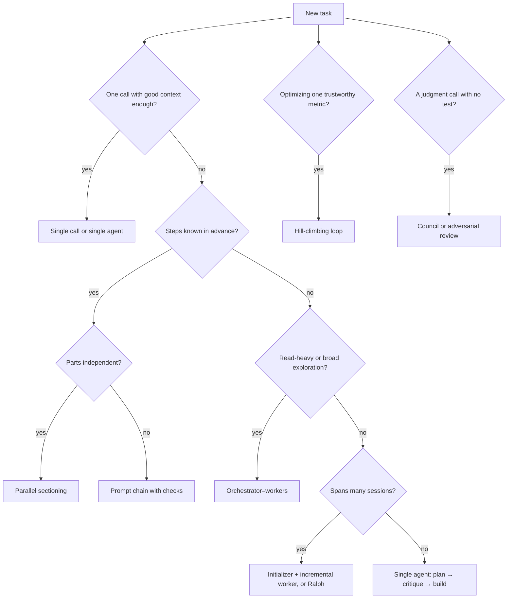

<!-- Generated by tools/build_index.py from playbook/agent-harness-playbook.md. Do not edit; rebuild. -->
## 6. Orchestration patterns
*Read when: you are choosing how many agents to run and how they hand work to each other.*

**Page terms.** Orchestration patterns (the page's "shapes", Lesson 7, "Pick the right shape for the job").

| # | Pattern | Shape | Use when | Cost and risk | Source |
|---|---|---|---|---|---|
| 1 | Prompt chaining | Fixed steps with checks between them | The task splits into known stages | Low; brittle if a stage varies | [P] Building effective agents |
| 2 | Routing | Classify, then dispatch | Inputs need different handling | Low; misroutes | [P] |
| 3 | Parallel sectioning | Split independent parts, run at once | Subtasks don't depend on each other | Tokens scale with parts | [P] |
| 4 | Parallel voting | Same task N times, compare | You need confidence or diverse attempts | N times the cost | [P] |
| 5 | Orchestrator–workers | Lead decomposes at runtime, workers report back | Subtasks can't be predicted ahead | About 15x chat tokens; coordination errors | [P] Building effective agents; multi-agent research |
| 6 | Evaluator–optimizer | Generate, critique, revise | Criteria are clear and iteration helps | Loops forever if criteria are vague | [P] |
| 7 | Plan → critique → execute | Plan file, fresh critic, then build | Multi-file or risky work | One extra review pass | [P] best practices; [S] team tips |
| 8 | Initializer + incremental worker | First session sets up the environment, a feature list and a progress file; each later session finishes one feature | Projects that span many sessions | Needs well-designed state files | [P] long-running harness |
| 9 | Ralph loop | A shell loop feeds the same prompt file to a fresh agent each pass; state lives on disk; one item per pass | A well-specified backlog with strong tests | Burns tokens and drifts if specs or tests are weak | [P] Huntley |
| 10 | Hill-climbing loop | Human edits the instructions file; agent edits the code; fixed time budget per attempt; one metric; keep if better, git reset if not; runs until interrupted | Optimization against one trustworthy metric | Metric gaming; the repo's instructions forbid editing the evaluation script, so enforce that with a read-only mount or code owners [D] | [P] Karpathy's autoresearch |
| 11 | Council | Independent answers, anonymized peer ranking, chair synthesis | Judgment calls, architecture options, research questions | About 9 model calls by default (4 answers, 4 reviews, 1 chair) [D]; the repo calls itself a vibe-coded Saturday hack, unsupported | [P] Karpathy's llm-council |
| 12 | Adversarial review | A fresh agent is told to break the plan or diff and return its strongest objections | Before irreversible or high-risk changes | False alarms; objections must be answered, not obeyed | [P] best practices; [D] |
| 13 | Research → plan → implement | Three separate phases, compacting to files between them; human reviews research and plan | Large or unfamiliar codebases | Discipline overhead | [P] HumanLayer |
| 14 | Day shift / night shift | Human-in-the-loop discovery and planning by day; an unattended loop works the sliced issues one by one, testing and typechecking every commit; QA findings become new issues | A backlog of well-sliced issues with strong checks | Needs a real sandbox | [P] Matt Pocock (the name is ours) |
| 15 | Compound loop | Plan, work, review, then capture what was learned so the next task is easier | Teams running many similar tasks | Rule bloat unless pruned | [P] Every |
| 16 | Goal loop | `/goal <condition>`: an evaluator re-checks the transcript after each turn and continues until the condition holds | A single session with a provable end state | The condition must be visible in output | [P] Claude Code docs |

The "cost and risk" column is our advice [D]; the source column names where each pattern comes from.

Two versions of "Ralph" exist. Huntley's original restarts a fresh process each pass. Anthropic's ralph-wiggum plugin re-feeds the prompt inside one session through a Stop hook. Dex Horthy (HumanLayer) has argued the plugin misses the key point of Ralph, a fresh context each pass. [S] One user's plugin loop set to `max_iterations: 0` ran 6,239 iterations over about 11.7 hours. Always set an iteration cap. [P: GitHub issue #1699]

---
