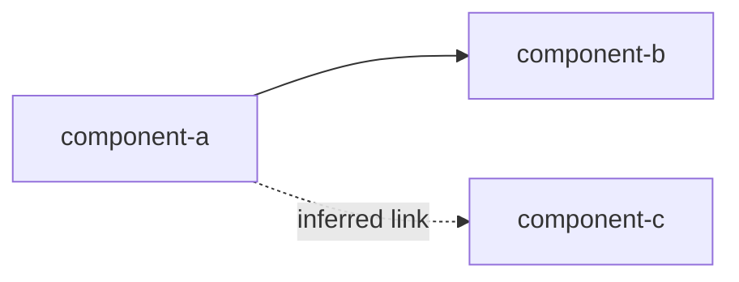

# REPO-NAME: architecture

## Bird's-eye view

One to three short paragraphs: the problem the repository solves, and how a request or data moves through it at the coarsest level.

## Diagram

## Boundaries and invariants

- What crosses each boundary, and how. Link the notes: [[component-a]].
- What is deliberately absent or always true.

## Build and test

- Install: `exact command` (from `path/to/file`)
- Test: `exact command` (from `path/to/file`)

## What this map can't see

- Runtime wiring, generated code, other repositories: whatever applies.
