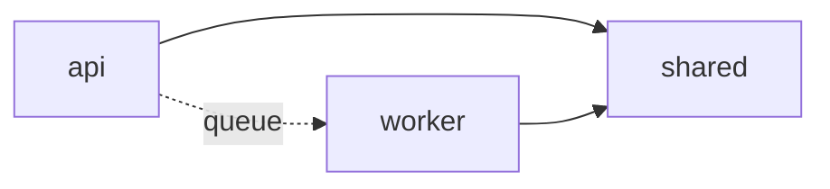

# Architecture

## Bird's-eye view

An order API takes orders and queues a receipt job; a worker sends the receipt. Shared data types sit between them.

## Diagram

## Boundaries and invariants

- The queue is the only link from [[api]] to [[worker]] ([[queue-between-api-and-worker]]).
- [[shared]] does no I/O.

## Build and test

- Test: `python3 -m unittest` (from `README.md`)

## What this map can't see

- The message broker: see [[which-broker]].
